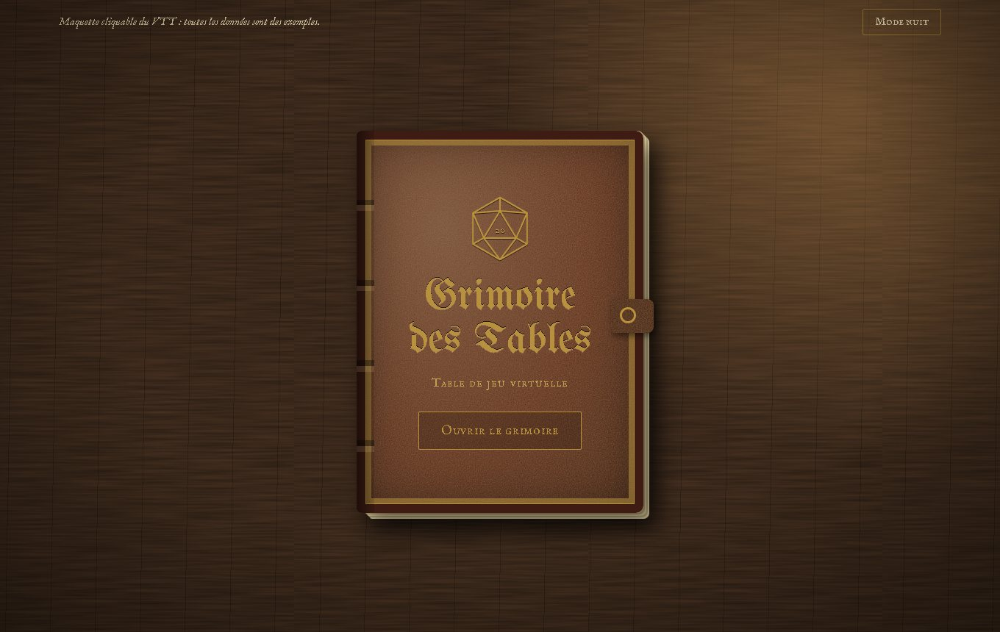
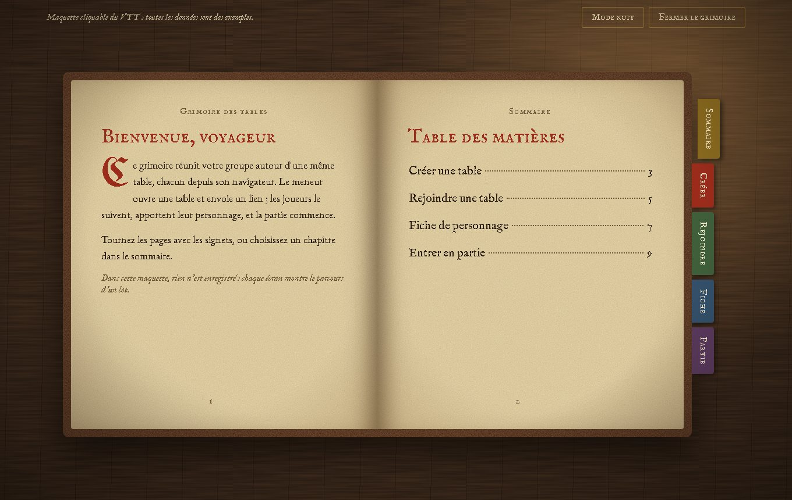
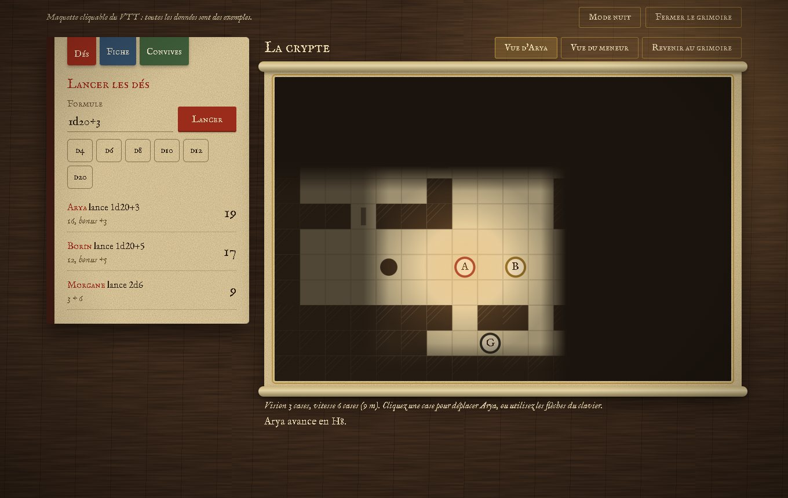
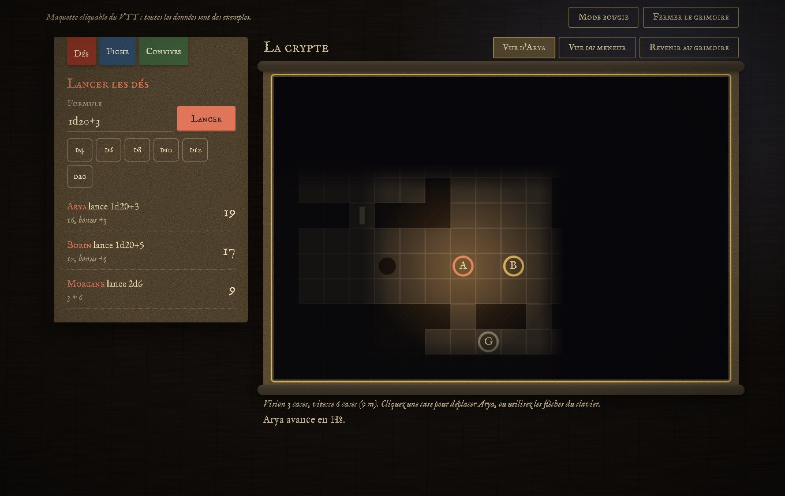

# VTT · table de jeu virtuelle

Une app web pour jouer à un jeu de rôle à plusieurs, chacun depuis son navigateur : le meneur crée une table, partage un lien, et les joueurs la rejoignent avec leur fiche de personnage, leurs dés et leurs pions.

Le but et les contraintes du projet sont dans [`INTENT.md`](INTENT.md) : il fait référence en cas de doute.

## Technologies

Next.js (TypeScript) déployé sur Vercel, Supabase pour la base, le temps réel et la connexion anonyme des joueurs. Les raisons de ce choix sont dans [`docs/decisions/`](docs/decisions/).

> État : le harnais de travail est posé ; l'application (Next.js) n'est pas encore installée.

## Direction artistique

Un grimoire de cuir posé sur une table de taverne, à la lueur d'une bougie. On ouvre le livre, et chaque menu est une double page jaunie ; on navigue avec les marque-pages. En partie, le livre devient un carnet (dés, fiche, convives) et la carte se déroule sur la table, avec le brouillard de guerre et la torche du personnage. Le mode sombre est un codex nocturne.

| Le grimoire fermé | Le sommaire |
|---|---|
|  |  |

| En partie, à la bougie | En partie, mode nuit |
|---|---|
|  |  |

La maquette cliquable est dans [`docs/design/maquette-grimoire.html`](docs/design/maquette-grimoire.html) : ouvrez-la dans un navigateur. Le design system de l'application en sera tiré.

## Installer le projet

Prérequis : Node.js, [pnpm](https://pnpm.io) et [Claude Code](https://code.claude.com).

```bash
git clone https://github.com/Nyulga/vtt.git
cd vtt
git checkout dev
pnpm install
cp .env.example .env.local   # puis renseigner les valeurs, jamais commitées
```

Outil MCP à installer une fois par développeur, avec sa propre clé (voir `CLAUDE.md`) :

```bash
claude mcp add --scope user --transport http context7 https://mcp.context7.com/mcp
```

## Commandes

| Commande | Rôle |
|---|---|
| `pnpm test` | lance les tests |
| `pnpm lint` | contrôle le style du code |
| `pnpm build` | construit l'app |
| `pnpm verifier` | vérification complète : lint, types, tests, tailles et complexité |

## Organisation du dépôt

| Emplacement | Contenu |
|---|---|
| `src/` | le code, en trois couches : présentation (`app`, `components`), service (`services`), données (`data`), plus l'assemblage (`composition`) |
| `_test_/` | tous les tests : `integration/` et `unitaires/<couche>/` |
| `docs/decisions/` | les décisions d'architecture (ADR) |
| `docs/design/` | la maquette du grimoire et ses captures |
| `lots.md` | le découpage du travail en lots, avec leurs critères d'acceptation |
| `CLAUDE.md`, `.claude/` | le harnais d'équipe : consignes, règles par couche, skills, agents, hooks et permissions |
| `.mcp.json` | les outils MCP partagés (Supabase, Playwright) |

## Travailler en équipe

- **Branches** : on travaille sur `dev`. `main` ne reçoit que des PR `dev` → `main`, vérifiées puis fusionnées par le responsable du projet ; jamais de commit direct sur `main`.
- **Lots** : chaque lot de `lots.md` a son issue GitHub (label `lot`) et se traite avec le skill `/lot N`. La session principale coordonne : tests d'intégration écrits et vus rouges d'abord, puis une étape par couche (service, données, assemblage, présentation) confiée à son agent codeur, avec un commit sur `dev` à chaque étape et un journal dans `docs/plan/journal/`.
- **Vérification** : à la fin de chaque lot, quatre agents relisent en parallèle : `revue` (critères, correction, tests), `conformite` (règles, design system, commentaires), `securite` et `non-regression`.
- **En parallèle** : un worktree par lot indépendant, créé et rangé avec le skill `/worktree`, dans `.claude/worktrees/`.
- **Garde-fous** : un hook bloque les commandes dangereuses (push sur `main` ou forcé, `rm -rf`, lecture des `.env`, fusion de PR) et un autre lance le lint après chaque modification.
- **Idées et bugs hors lot** : une issue GitHub, jamais du code « en passant ».
- **Commits** : format [Conventional Commits](https://www.conventionalcommits.org/fr/) (skill `git-conventional`), par exemple `feat(lot-1): créer une table et obtenir son lien`.
- **Secrets** : uniquement dans `.env.local`, jamais dans un fichier suivi par Git.
- **Règles de code** : `.claude/rules/00-principes.md` s'applique partout ; chaque couche a sa propre règle.
